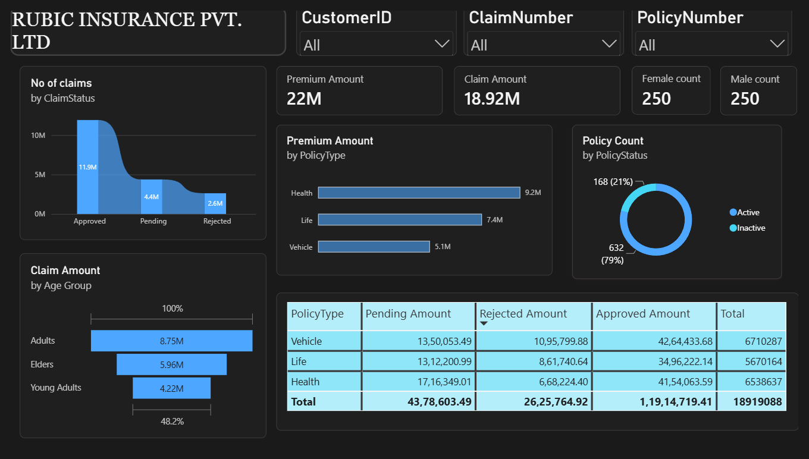
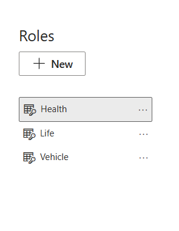
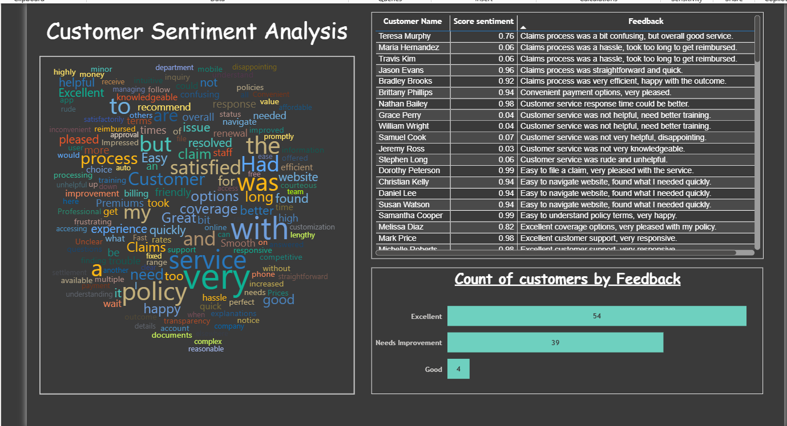
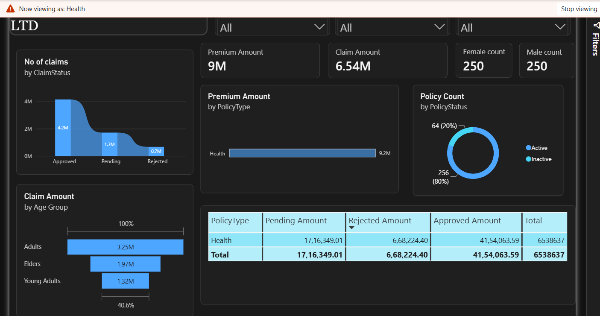

# Rubic Insurance Pvt. Ltd. – Power BI Dashboard

## 📊 Project Overview
This Power BI project analyzes policy sales, customer demographics, claims, and feedback
sentiment for a simulated insurance provider, Rubic Insurance Pvt. Ltd. The dashboard was
built to practice end-to-end BI delivery: data modeling, DAX measures, role-based security,
and scheduled refresh, applied to an insurance operations use case.

The project showcases my skills in:
- Data cleaning and transformation using **Power Query**
- Star-schema **data modeling and DAX measure** design
- **Role-Level Security (RLS)** for department-specific dashboard views
- Keyword-based sentiment scoring on customer feedback text
- Publishing and **scheduled refresh** in **Power BI Service**

---

## 🧭 Dashboard Snapshots

**1️⃣ Main Dashboard View**
Summarizes policy sales, premium revenue, and claim activity across policy types and regions.

**2️⃣ Roles & Access Setup**
Implemented **role-level security (RLS)** to provide different access views for Admin, Manager, and Analyst roles within the Power BI Service.

**3️⃣ Customer Feedback & Sentiment View**
This report visualizes **customer feedback polarity** **(positive, neutral, negative)** using sentiment scoring techniques and Power BI visuals.

**4️⃣ Viewing as a "Health" Role**
A demonstration of Power BI’s r**ole-based filtering** — here showing how the dashboard adapts dynamically when viewed under the **Health department role**.

.

---

## ⚙️ Key Features
| Feature | Description |
|---|---|
| **Data Source** | Mock Excel dataset: policies, customers, claims, feedback text |
| **Data Cleaning** | Performed using Power Query Editor |
| **Modeling** | Star schema with Policy fact table + Customer, Region, Date dimensions |
| **Visualization** | KPI cards, donut chart, bar chart, sentiment visual, slicers |
| **RLS Implementation** | Health, Vehicle, and Life insurance role-based views |
| **Publishing** | Dashboard published to Power BI Service |
| **Automation** | Scheduled Refresh configured for data synchronization |

---

## 💡 Insights Derived
- Health Insurance policies generated the highest customer satisfaction scores.
- Negative feedback was mainly tied to claim processing delays.
- Sales peaked during Q2 and Q4, indicating seasonal marketing influence.
- Role-based dashboards improved data confidentiality and accessibility.
- Automated refresh schedules improved report reliability.

---

## 🧠 Tools & Technologies Used
- Microsoft Power BI Desktop
- Power BI Service
- Power Query Editor
- DAX (Data Analysis Expressions)
- Excel (data source)

---

## 📈 Skills Demonstrated
- Data modeling and ETL using Power Query
- DAX measure and calculated column design
- Role-Level Security (RLS) implementation
- Text-based sentiment scoring
- Dashboard publishing and scheduled refresh

---

## 🔄 Publishing & Collaboration
- Built and tested the report in Power BI Desktop
- Published to Power BI Service
- Configured RLS roles and validated using "View as Role"
- Set up Scheduled Refresh for ongoing data updates

---

## 🏁 Conclusion
This project applies core Power BI skills — data modeling, DAX, RLS, and sentiment
analysis — to a simulated insurance operations scenario, demonstrating how raw policy and
feedback data can be turned into role-specific, actionable reporting.

---

## 📷 Dashboard Snapshots Summary

| View | Screenshot |
|---|---|
| **Main Dashboard** |  |
| **Roles & Access Setup** |  |
| **Viewing as Health Role** |  |
| **Customer Sentiment View** |  |

### 👨‍💻 Developed By
Abirami N — *Analyst, Process Management*
📧 abiraminachimuthu45@gmail.com
🔗 [LinkedIn](https://www.linkedin.com/in/abirami0825) | 💻 [GitHub](https://github.com/Abirami-N-25)
